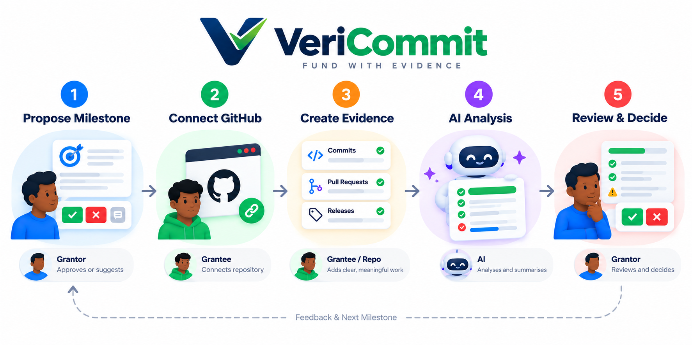

  

<h1 align="center">VeriCommit</h1>

<strong>Fund with Evidence.</strong>

VeriCommit is an AI-powered grant management and milestone verification tool that helps grantors and grantees track funded software projects, evaluate GitHub contributions against agreed milestones, and make evidence-based funding decisions.

## The VeriCommit Evidence Workflow

  

## The Problem

Grantors fund software projects but may struggle to verify progress against agreed milestones. Grantees, meanwhile, need a clear and fair way to demonstrate what they have delivered.

VeriCommit helps both parties work from shared expectations and verifiable evidence.

## How It Works

1. **Agree on a milestone**  The grantor defines the expected outcome and acceptance criteria. The grantee can ask questions or suggest revisions before approval.
2. **Connect GitHub evidence**  The grantee provides the project repository.
3. **Record development work**  Commits, pull requests, releases, and other available evidence help demonstrate progress.
4. **Evaluate the evidence**  AI compares available evidence with the previously agreed milestone and identifies supported claims, missing evidence, and uncertainties.
5. **Review and decide**  The grantor reviews the report and makes the final funding or milestone decision.

## MVP Goal

Demonstrate an end-to-end workflow in which a user can:

- Define a milestone and its acceptance criteria.
- Provide a GitHub repository or use clearly labelled sample evidence.
- Generate an AI-assisted milestone evaluation.
- Review evidence supporting progress, missing evidence, and uncertainties.
- Present the report to a human reviewer for a final decision.

## Product Principles

- **Evidence before assumptions:** Evaluations must be grounded in available evidence.
- **Clear expectations:** Milestones and acceptance criteria are agreed upon before evaluation.
- **Transparency:** Users can distinguish supported findings, missing evidence, and uncertainty.
- **Human accountability:** AI supports the review; it does not make funding decisions.
- **Fairness:** Commit counts alone do not prove quality, completion, or impact.
- **Privacy and access:** Repository access and evidence handling must respect permissions.

## What the MVP Does Not Promise

- Automatic release or transfer of grant funds.
- Proof that every contribution is original, correct, or production-ready.
- A complete grant-management platform.
- A production integration with Stellar or Drips.

Stellar and Drips may be explored as future integrations, but they are not prerequisites for demonstrating the MVP.

## Team Responsibilities

- **Product lead:** Product direction, requirements, prioritization, coordination, and demo narrative.
- **Backend lead  Joshua:** Repository evidence retrieval, evaluation workflow, AI integration, and backend API.
- **Frontend lead  Wale:** Milestone input, evaluation report, and reviewer experience.

The backend and frontend leads should agree on the API contract before depending on shared request and response structures.

## Success Criteria

The MVP succeeds when a reviewer can follow a milestone from agreed expectations through GitHub evidence and an AI-assisted report to a human decision.

We will assess the product across:

- **Human Desirability:** Does it help grantors and grantees understand progress and build trust?
- **Technical Feasibility:** Can we demonstrate the workflow reliably with free tools?
- **Economic Viability:** Is the approach practical enough to justify further development?

## Product Documentation

- [Product Brief](docs/PRODUCT_BRIEF.md)
- [MVP Scope](docs/MVP_SCOPE.md)
- [API Contract](docs/API_CONTRACT.md)
- [AI Evaluation Rules](docs/AI_EVALUATION_RULES.md)
- [Team Backlog](docs/TEAM_BACKLOG.md)
- [Entity Relationships](docs/domain-model/ENTITY_RELATIONSHIPS.md)

## Project Status

This is a hackathon MVP. Requirements and integrations may evolve as the team validates the workflow.
