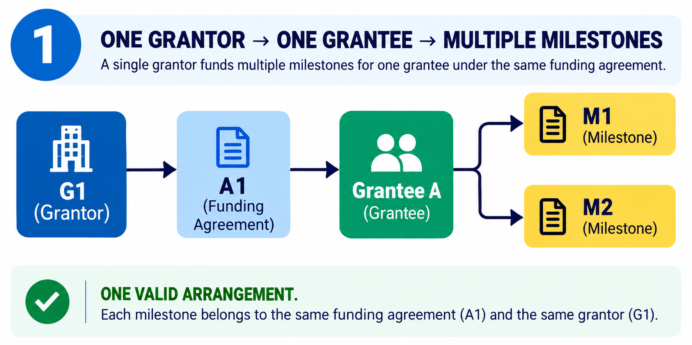
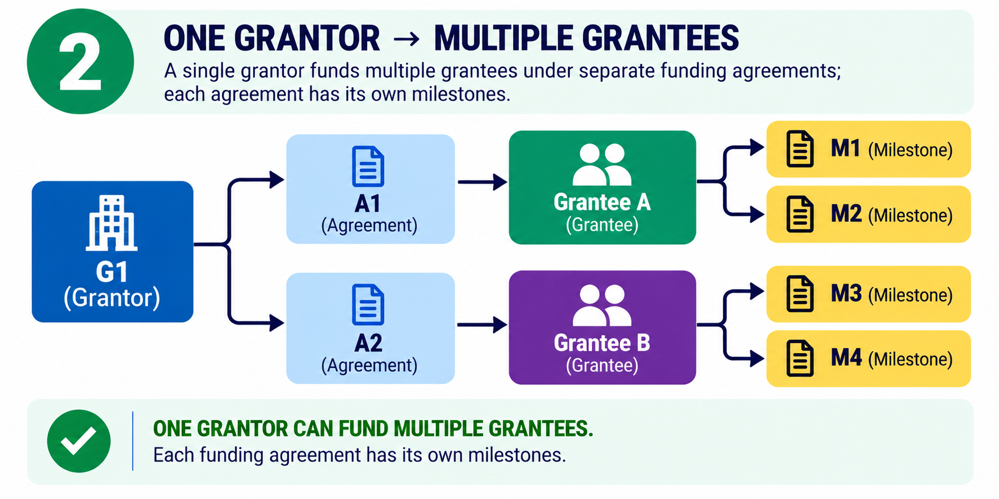
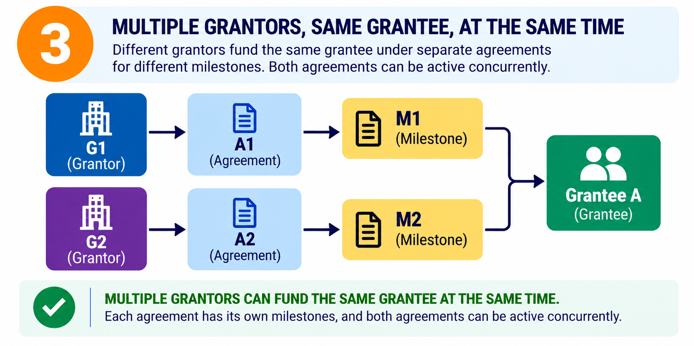
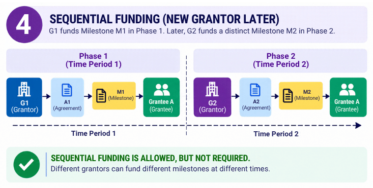
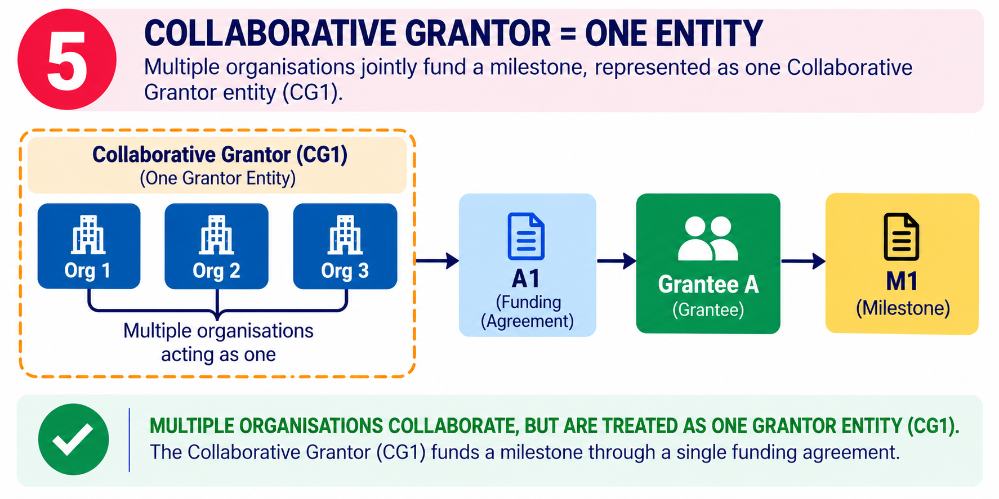
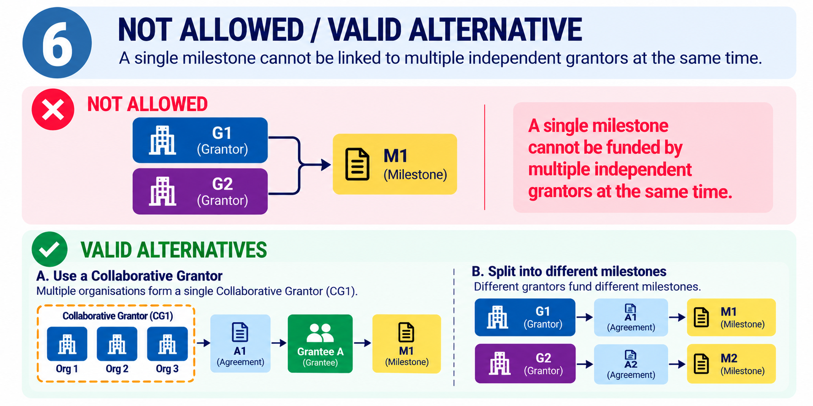

# VeriCommit Entity Relationships

**Status:** Proposed - requires team review  
**Document type:** Domain Model / Entity Relationship Specification  
**Scope:** Grantors, Grantees, Funding Agreements, and Milestones
***
 

  

 

## 1. Purpose

This document defines how Grantors, Grantees, Funding Agreements, and Milestones relate within VeriCommit. It establishes the relationship rules that product decisions, database design, API contracts, implementation, and tests must follow.

## 2. Core Principle

**Each Milestone belongs to exactly one Funding Agreement at a time. Each Funding Agreement has exactly one responsible Grantor entity and one Grantee.**

A Grantor entity may be an individual organization or a formally defined Collaborative Grantor representing multiple organizations acting together as one entity.

A Grantee may have multiple active Funding Agreements with different Grantors simultaneously. The single-Grantor restriction applies to each Funding Agreement and its Milestones, not to the Grantee as a whole.

## 3. Domain Entities

### 3.1 Grantor

An individual organization or formally defined Collaborative Grantor that enters into a Funding Agreement with a Grantee.

### 3.2 Grantee

An individual, team, or organization receiving funding under one or more Funding Agreements.

### 3.3 Funding Agreement

The explicit record connecting one responsible Grantor entity to one Grantee for a defined scope of work.

A Funding Agreement defines the agreed terms, scope, milestones, timelines, and applicable funding commitments.

### 3.4 Milestone

A defined deliverable, stage, or outcome within a Funding Agreement. It has agreed acceptance criteria and may have associated evidence, evaluations, and human decisions.

### 3.5 Collaborative Grantor

A formally defined Grantor entity representing multiple organizations that have agreed to act together under one funding arrangement.

For relationship purposes, the Collaborative Grantor counts as one Grantor entity. Its internal participants and responsibilities must be documented separately where applicable.

## 4. Relationship Cardinality

| Relationship | Cardinality | Rule |
|---|---|---|
| Grantor to Funding Agreement | One-to-many | A Grantor may enter into multiple Funding Agreements. |
| Grantee to Funding Agreement | One-to-many | A Grantee may participate in multiple Funding Agreements. |
| Funding Agreement to Grantor | Many-to-one | Each Funding Agreement has exactly one responsible Grantor entity. |
| Funding Agreement to Grantee | Many-to-one | Each Funding Agreement has exactly one Grantee for this model. |
| Funding Agreement to Milestone | One-to-many | An agreement may define multiple milestones. |
| Milestone to Funding Agreement | Many-to-one | Each Milestone belongs to exactly one Funding Agreement at a time. |

Consequently, Grantors and Grantees have a many-to-many relationship through Funding Agreements. They are not linked by an unrestricted direct relationship that bypasses the agreement.

## 5. Permitted Scenarios

### 5.1 One Grantor, One Grantee, Multiple Milestones

One Grantor funds one Grantee under one Funding Agreement containing multiple Milestones.

All those milestones belong to that agreement.

*Figure 1. One Grantor funds one Grantee through a single Funding Agreement containing multiple Milestones.*

### 5.2 One Grantor, Multiple Grantees

One Grantor may enter into separate Funding Agreements with multiple Grantees.

Each agreement has its own scope and milestones. Milestones belonging to one agreement must not automatically become part of another agreement.

*Figure 2. One Grantor may fund multiple Grantees through separate Funding Agreements, each with its own milestones.*
### 5.3 Multiple Independent Grantors Funding One Grantee Simultaneously

A Grantee may have multiple active Funding Agreements with different Grantors at the same time.

For example:

- Grantor G1 funds Milestone M1 under Agreement A1.
- Grantor G2 funds Milestone M2 under Agreement A2.
- Both agreements may be active concurrently.

Each milestone belongs to its own agreement. The Grantee is not required to finish all work funded by one Grantor before receiving funding from another Grantor for a different scope.

*Figure 3. Two independent Grantors may concurrently fund different milestones for the same Grantee through separate Funding Agreements.*
### 5.4 Sequential Funding

A Grantor may fund an earlier phase, and another Grantor may later fund a subsequent phase.

The later funding must be represented by its own Funding Agreement. Sequential funding is permitted but is not mandatory for all funding relationships.

A later agreement must explicitly define its scope and must not silently rewrite the terms or history of an earlier agreement.
 

  

 
*Figure 4. Different Grantors may fund a Grantee at different times through separate Funding Agreements, with each agreement defining its own scope.*

### 5.5 Collaborative Grantor

Multiple organizations may jointly fund a Grantee under one Funding Agreement if they are formally represented as one Collaborative Grantor entity for that arrangement.

The agreement has one responsible Grantor entity: the Collaborative Grantor.

This does not mean that any two independent Grantors automatically become a Collaborative Grantor merely because they support the same Grantee or project.

*Figure 5. Multiple organizations may jointly fund a Grantee through one Funding Agreement when they are formally represented as a single Collaborative Grantor entity.*

## 6. Prohibited Scenarios

### 6.1 One Milestone Assigned to Multiple Independent Grantors

A single Milestone must not be assigned simultaneously to two independent Grantor entities under one Funding Agreement.

If multiple organizations jointly fund that same milestone, they must be represented by one formally defined Collaborative Grantor entity under the agreement.

*Figure 6. Independent Grantors must not simultaneously fund the same Milestone under one Funding Agreement; valid alternatives include a formally defined Collaborative Grantor or separate Milestones under separate agreements.*

### 6.2 Implicit Sharing of Responsibilities

A Grantor must not be assumed to share responsibility for another Grantor's Funding Agreement or Milestones merely because both fund the same Grantee.

### 6.3 Unauthorized Changes to Milestone or Funding Agreement Ownership

An approved Milestone must not be moved directly from one Funding Agreement to another. If a correction or reassignment is necessary, it must follow an authorized process that preserves the original Milestone record, its relationship history, and all associated evidence, evaluations, and human decisions.

A Funding Agreement may be transferred to another responsible Grantor only through an explicitly authorized process that includes acknowledgement by the Grantee and a clear audit trail identifying the former Grantor, the new Grantor, the authorization, and the effective date.

Historical evaluations and decisions must remain traceable to the Funding Agreement and responsible Grantor applicable when those evaluations and decisions were made.

The full Milestone correction, reassignment, and Funding Agreement transfer workflows are deferred beyond the MVP. These rules establish domain constraints and future implementation requirements; they do not imply that the workflows are currently available.

## 7. Relationship Lifecycle and Changes

A Funding Agreement may be proposed, accepted, active, amended, completed, terminated, or otherwise closed according to the product's agreed lifecycle rules.

Changes to a Milestone's scope or acceptance criteria must follow an explicitly authorized process and preserve the relevant change history.

Once a Milestone has been approved under a Funding Agreement, it must not be moved directly to another Funding Agreement. Any necessary correction or reassignment must follow an authorized process that preserves the original Milestone record, its relationship history, and all associated evidence, evaluations, and human decisions.

A Funding Agreement may be transferred to another responsible Grantor only through an explicitly authorized process that includes acknowledgement by the Grantee. The audit trail must record the former Grantor, the new Grantor, the authorization, the effective date, and the reason for the transfer.

The implementation must distinguish between:

- A new Milestone under an existing Funding Agreement.
- An explicitly approved amendment to an existing Milestone.
- A new Milestone under a different Funding Agreement.
- A completed or terminated agreement followed by a new agreement.
- An authorized transfer of an existing Funding Agreement to another responsible Grantor.

Historical evaluations and decisions must remain traceable to the Milestone, Funding Agreement, and responsible Grantor applicable when those evaluations and decisions were made.

The full Milestone correction, reassignment, and Funding Agreement transfer workflows are deferred beyond the MVP. These domain rules must be documented now, but implementation of the workflows requires a later product and engineering decision.

The exact statuses and transition permissions must be defined in the relevant lifecycle specification before implementation.

## 8. Transparency and Permissions

VeriCommit should make relevant funding relationships and Milestone outcomes visible only to authorized parties.

The existence of multiple Funding Agreements must not automatically expose one agreement's private budget, terms, correspondence, or evidence to other Grantors.

Cross-funder visibility must be explicitly authorized and scoped. A Grantee may share an appropriate record of prior work with a prospective Grantor without granting unrestricted access to other Funding Agreements.

## 9. Implementation Invariants

The application and its data model must enforce the following invariants:

1. Every Milestone references exactly one Funding Agreement at a time.
2. Every Funding Agreement references exactly one responsible Grantor entity.
3. Every Funding Agreement references exactly one Grantee under this model.
4. A Grantee may have multiple active Funding Agreements with different Grantors.
5. Different Grantors may fund different Milestones for the same Grantee concurrently.
6. A Collaborative Grantor is represented as one Grantor entity for the relevant agreement.
7. Agreement and Milestone changes must be authorized and traceable.
8. Evidence, evaluations, and human decisions must remain associated with the appropriate Milestone and Funding Agreement.
9. Private information must not become visible to other Grantors merely because they fund the same Grantee.
10. The AI evaluation process must not independently approve funding or change Funding Agreement ownership.
11. An approved Milestone must not be moved directly to another Funding Agreement; any authorized correction or reassignment must preserve its original record and history.
12. A Funding Agreement transfer must require explicit authorization, Grantee acknowledgement, and an audit trail identifying the former Grantor, new Grantor, effective date, and reason.

These invariants define the domain constraints. They do not imply that the deferred transfer and reassignment workflows are available in the MVP.

## 10. Acceptance Criteria

The relationship model is acceptable when automated tests demonstrate that:

- One Grantor can fund multiple Grantees through separate Funding Agreements.
- One Grantee can have multiple active Funding Agreements with different Grantors.
- Different Grantors can concurrently fund different Milestones for the same Grantee.
- Each Milestone is associated with exactly one Funding Agreement at a time.
- Multiple organizations can jointly fund under one explicitly defined Collaborative Grantor entity.
- A Milestone cannot be simultaneously assigned to multiple independent Grantor entities.
- Sequential funding can be recorded without overwriting prior Funding Agreement history.
- Unauthorized changes and unauthorized cross-funder access are rejected.
- Evidence and evaluation records remain traceable to the correct Milestone and Funding Agreement.
- The domain rules prohibit direct reassignment of an approved Milestone to another Funding Agreement.
- The domain rules require authorization, Grantee acknowledgement, and an auditable record for Funding Agreement transfers.
- AI evaluation cannot independently approve funding or change agreement ownership.

The transfer and reassignment workflow tests must be implemented when those workflows are approved for development. Their inclusion as domain requirements does not make them MVP functionality.

## 11. Related Documentation

- [Product Brief](../PRODUCT_BRIEF.md)
- [MVP Scope](../MVP_SCOPE.md)
- [API Contract](../API_CONTRACT.md)
- [AI Evaluation Rules](../AI_EVALUATION_RULES.md)
- [Domain Entities](DOMAIN_ENTITIES.md) 
- [Domain Rules](DOMAIN_RULES.md) 
- [Domain Diagrams](DOMAIN_DIAGRAMS.md) 

## 12. Governance

This document is a proposed domain specification, not proof that every rule has been implemented.

Changes to relationship cardinality or core invariants require explicit product and engineering review. The API contract, database constraints, application behavior, and automated tests must be updated together when an approved change affects them.

The implementation status of any domain rule must be distinguished from its specification status. Deferred workflows must not be represented as implemented functionality.
